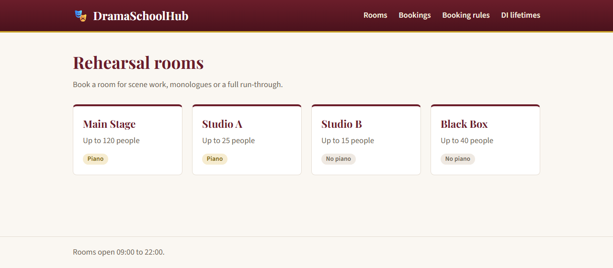
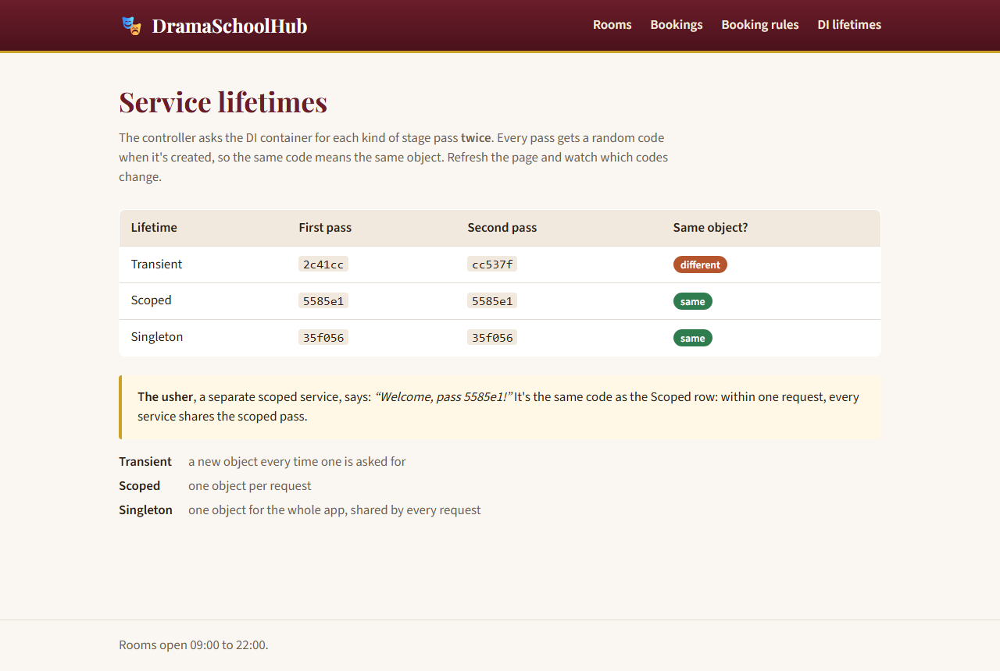
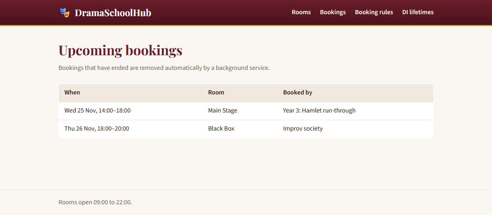
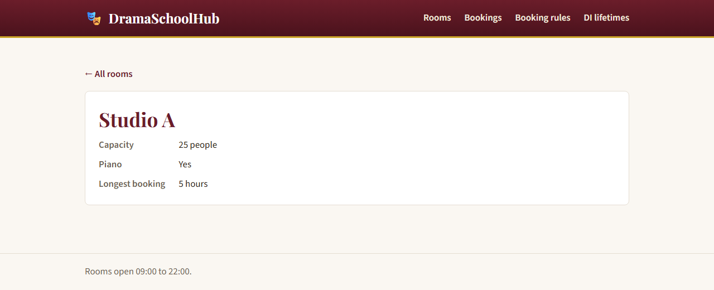
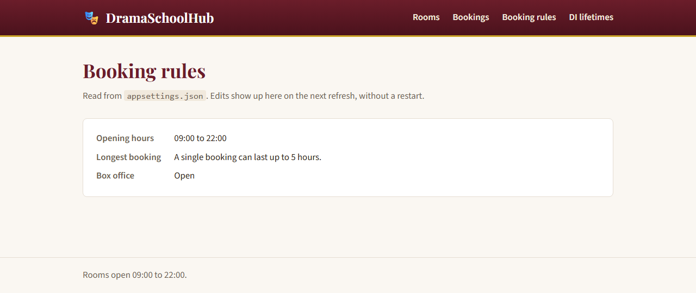

# DramaSchoolHub

[](https://github.com/parisoiko/DramaSchoolHub/actions/workflows/ci.yml)


A small rehearsal-room booking site for a drama school, built with **ASP.NET Core 10** to explore
**dependency injection** and the **middleware pipeline** in depth: service lifetimes, the Options pattern,
captive dependencies, thread-safe singletons, background services, custom middleware, filters and keyed services.

I built it while following the Pluralsight course *Applying Dependency Injection & Middleware in ASP.NET Core 10*.
The course builds a tennis-court booking app; I applied every module to my own theme instead and covered each step with tests.



## Features

- **Rooms**: the school's rehearsal rooms, each with its own page (`/rooms/2`) showing capacity, piano and the longest allowed booking
- **Bookings**: upcoming bookings, kept in a thread-safe in-memory store; a background service removes the ones that have ended
- **Booking rules**: opening hours and booking length from `appsettings.json`, validated at start-up and editable while the app runs
- **DI lifetimes page**: a live demo of transient, scoped and singleton services (refresh it and watch which codes change)
- **Box office mode**: one setting turns every page away with a 503, while static files and the `/ping` health check keep working
- **JSON API**: `/api/rooms`, `/api/rooms/{id}`, `/api/bookings` and notification previews

| Service lifetimes, live | Upcoming bookings |
|---|---|
|  |  |

| Room details | Booking rules |
|---|---|
|  |  |

## What it demonstrates

| Concept | Where |
|---|---|
| Constructor injection and coding to interfaces | `Controllers/HomeController.cs`, `Services/IRoomCatalogue.cs` |
| Transient, scoped and singleton lifetimes | `Services/StagePass.cs`, `Controllers/LifetimesController.cs` |
| Options pattern with start-up validation (`[Range]`, `Validate`, `ValidateOnStart`) | `Models/BookingRules.cs`, `Extensions/ServiceCollectionExtensions.cs` |
| `IOptions` vs `IOptionsSnapshot` (settings that change without a restart) | footer in `Views/Shared/_Layout.cshtml` vs `Controllers/RulesController.cs` |
| Action injection with `[FromServices]` | `HomeController.Room` |
| Injection into minimal APIs and Razor views (`@inject`) | `Program.cs`, `Views/Shared/_Layout.cshtml` |
| Captive dependencies and scope validation | `Services/Usher.cs` (scoped, takes a scoped pass) |
| A thread-safe singleton | `Services/BookingStore.cs` (`lock` around every read and write) |
| Disposal by the container | `Services/Usher.cs` (`IDisposable`) |
| A hosted service that creates its own scope | `Services/BookingCleanupService.cs` |
| Inline and class-based middleware, ordering, short-circuiting | `Program.cs`, `Middleware/RequestTimingMiddleware.cs`, `Middleware/BoxOfficeMiddleware.cs` |
| Scoped services in middleware (`InvokeAsync` parameters) | `Middleware/BoxOfficeMiddleware.cs` |
| Pipeline branching with `app.Map` | `/ping` in `Program.cs` |
| An MVC action filter (and why it isn't middleware) | `Filters/AuditFilter.cs` |
| Several implementations of one interface, `IEnumerable<T>` | `Notifications/`, `/api/notifications/preview` |
| Keyed services (`[FromKeyedServices]`) | `/api/notifications/preview/urgent` |
| Registration extension methods | `Extensions/ServiceCollectionExtensions.cs` |

The reasoning behind each of these is in my study notes: [docs/NOTES.md](docs/NOTES.md).

## The request pipeline

```
request ──► RequestTiming ──► X-Theatre header ──► StaticFiles ──► BoxOffice ──► Routing ──► MVC / minimal APIs
                                                       │
                                                       └── /ping ──► "pong"
```

The order is deliberate: the timer is first so it measures everything; the box office comes after static files so its
"closed" page still loads the CSS; and `/ping` branches off before the box office so monitoring keeps working when it's closed.

## Tech stack

| Area | Technology |
|---|---|
| Web | ASP.NET Core 10 MVC, Razor views, minimal APIs |
| DI | Microsoft.Extensions.DependencyInjection: lifetimes, Options, keyed services, hosted services |
| Tests | xUnit, `WebApplicationFactory` integration tests (37 tests) |
| CI | GitHub Actions: build and test on every push |

No database: the rooms and bookings live in memory, because the project is about DI and the pipeline, not data access.

## Project structure

```
src/DramaSchoolHub/
├── Controllers/      Home (rooms), Bookings, Rules, Lifetimes
├── Extensions/       registration extension methods (AddDramaSchoolServices, ...)
├── Filters/          AuditFilter (MVC action filter)
├── Middleware/       request timing, box office
├── Models/           RehearsalRoom, Booking, BookingRules, view models
├── Notifications/    INotificationSender with email and SMS implementations
├── Services/         room catalogue, booking store, cleanup service, lifetime demo
├── Views/            Razor views
└── wwwroot/          CSS
tests/DramaSchoolHub.Tests/   unit and integration tests, grouped by feature
docs/                         study notes and screenshots
```

## Getting started

**Requirement:** the [.NET 10 SDK](https://dotnet.microsoft.com/download). Nothing else: there's no database to set up.

```bash
git clone https://github.com/parisoiko/DramaSchoolHub.git
cd DramaSchoolHub
dotnet run --project src/DramaSchoolHub
```

Then open http://localhost:5090. In VS Code, F5 ("Run DramaSchoolHub") builds, starts and opens the browser.

Things to try:
- Refresh **DI lifetimes** and watch which codes change.
- With the app running, set `"BoxOfficeClosed": true` in `src/DramaSchoolHub/appsettings.json`, save and refresh: the site
  closes without a restart. `/ping` still answers.
- Set `"MaxBookingHours": 0` and restart: the app refuses to start and names the bad setting.
- Watch the console: every request logs its duration, and every MVC action logs its arguments.

## Tests

```bash
dotnet test
```

- **Unit tests**: `HomeController` with a fake catalogue passed straight into its constructor.
- **Integration tests** (`WebApplicationFactory<Program>`): the real app runs in memory, with settings or services
  swapped per test. They cover each lifetime, the captive-dependency check, disposal, options binding and validation,
  20,000 parallel bookings against the singleton store, the cleanup service, the middleware order (box office, static
  files, `/ping`), the audit filter, and the keyed notification sender.

## Credits

Built while following *Applying Dependency Injection & Middleware in ASP.NET Core 10* by Steve Gordon on Pluralsight.
The drama-school theme, the code and the tests are my own.

## License

[MIT](LICENSE)
